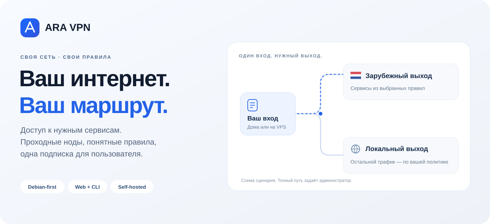
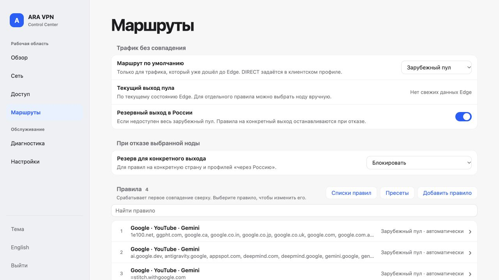
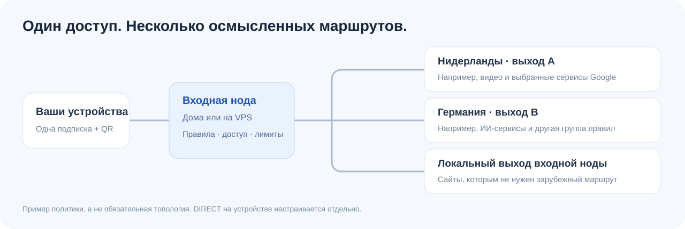
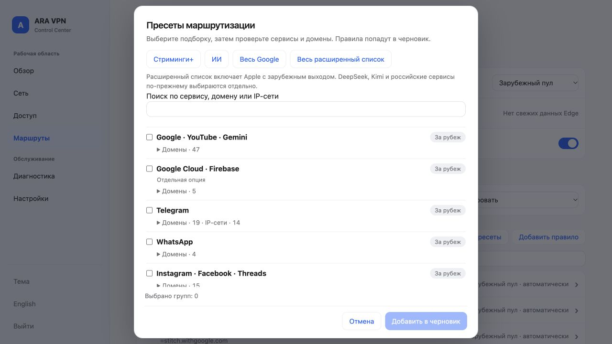
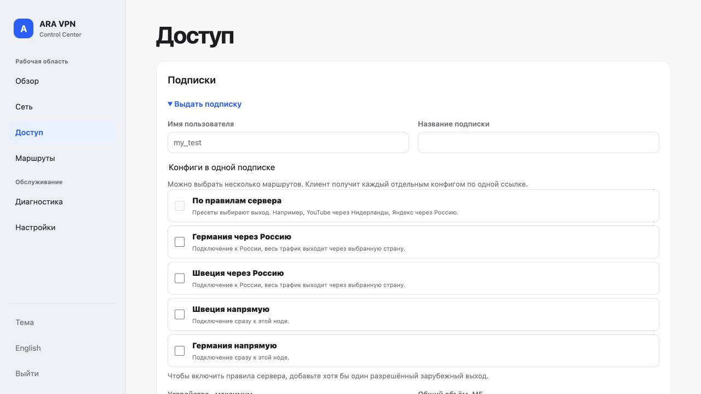

<p align="center"></p>

<h1 align="center">ARA VPN</h1>
<p align="center"><strong>Your entry point. The exit you choose. One place to manage access.</strong></p>
<p align="center"><a href="README.md">Русский</a> · <a href="docs/GETTING_STARTED.md">Installation</a> · <a href="https://github.com/ARA-VPN-Project/ARA-VPN/releases/latest">Download</a> · <a href="docs/SCREENSHOTS.md">Screenshots</a></p>

**Build a self-hosted VPN network for censorship circumvention.** Connect an entry node to an overseas exit, choose service rules and share one subscription with several useful profiles. Keep your infrastructure, access credentials and routing under your control, without a mandatory ARA cloud account.



## Four ways to use it

| Scenario | How it works | What you need |
|---|---|---|
| Entry VPS + overseas exit | Devices connect to a nearby entry. Selected services leave through an overseas node; other traffic follows your policy. Add another exit for different rules. | Reachable Debian servers and the appropriate transport/TLS configuration |
| Home entry + Netherlands exit | A Debian host at home receives connections and forwards selected traffic overseas. Other traffic may leave through your home connection. | A public, reachable home IP and a router that supports port forwarding. CGNAT cannot be solved by a port-forward rule alone; dynamic addresses also need current DNS/DDNS. |
| One overseas node | A standard VPN connection straight to that exit, with authentication and limits. | One reachable Debian node; no home entry is required |
| Family or small team | One subscription, separate device identities, a shared budget, optional per-profile speed and volume limits. | Give each device its own identity; copying one QR does not create separate physical-device tracking |



## What you manage

- Service presets, domain/CIDR rules, named exits and explicit failure behavior.
- Direct VPN and multi-hop profiles in one subscription, share links and QR.
- Accounts, devices, registration slots, expiration, revocation, rates and volume.
- Linked Control Centers with delegated permissions and one authoritative subscription owner.
- Node availability, latency, traffic history and bounded segment speed tests.
- A web UI in Russian/English and CLI/API for repeatable administration.

## Install

```sh
curl -q -fsSL --proto '=https' --proto-redir '=https' https://raw.githubusercontent.com/ARA-VPN-Project/ARA-VPN/v0.1.1/install.sh | sudo sh
```

Use Debian with systemd. The main qualified platform is Debian 13 amd64; ARMv7 has user-mode QEMU qualification. The wizard accepts a hostname or IP, proposes panel port **29445**, configures the selected TLS mode and prints the full private panel URL, username and initial password. Loopback is the default bind; remote exposure is an explicit choice.

Configure the exit first, then the ingress, link them, apply routing and issue a subscription. **Installing packages does not automatically bootstrap an arbitrary remote transport topology.** Initial listener/adapter preparation remains a console step. Daily access and routing management is available in the panel. [Full installation guide](docs/GETTING_STARTED.md) · [CLI and agent instructions](docs/AGENT_QUICKSTART.md).

A domain is optional, but clients must trust your certificate. A public DNS name is convenient for ACME and HTTPS subscriptions. Home installations need a Debian computer/VM; this is not firmware for arbitrary consumer routers.

## See the interface

<table><tr><td></td><td></td></tr><tr><td>Review services before adding rules.</td><td>Offer several useful routes through one subscription.</td></tr></table>

[Full gallery](docs/SCREENSHOTS.md) · [Use cases](docs/USE_CASES.md) · [Transport roles](docs/PROTOCOLS.md)

## Scope and evidence

ARA orchestrates standard transports; it is not a new VPN protocol. Client ingress capabilities differ from inter-node transport capabilities. A successful subscription fetch is not proof of a working tunnel. Test egress, limits and failures in your own topology. No universal censorship/DPI bypass is promised.

0.1.1 is accepted within its documented native Debian scope. An independent sing-box client was used for interoperability checks. Docker runtime, physical ARMv7 and individual mobile applications are not claimed as separately qualified. [Acceptance report](docs/ACCEPTANCE_0.1.1.md).

## License

ARA-authored code: **[AGPL-3.0-or-later](LICENSE)**. Commercial use is permitted subject to the license. Dependencies retain their own terms; sing-box remains GPL-3.0-or-later. [Notices](NOTICE) · [Corresponding source](SOURCES.md).
