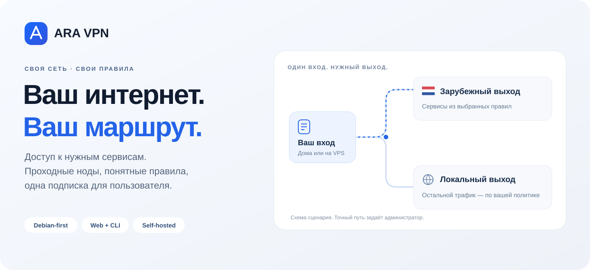
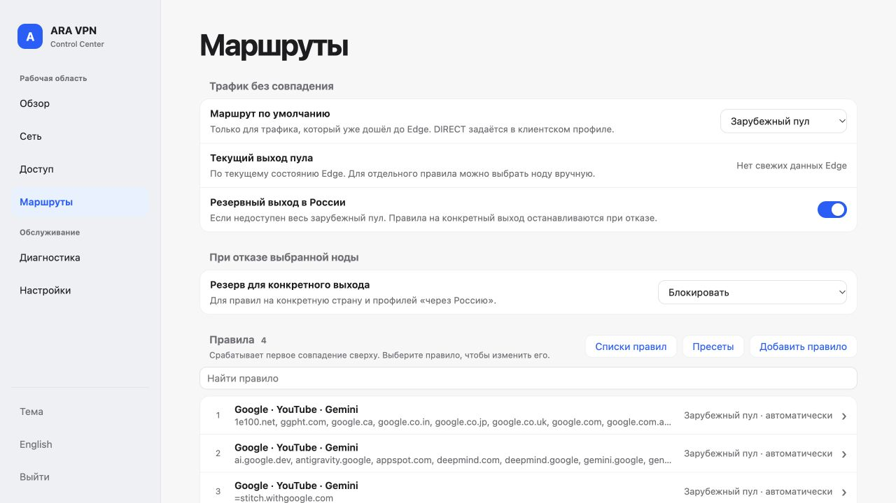
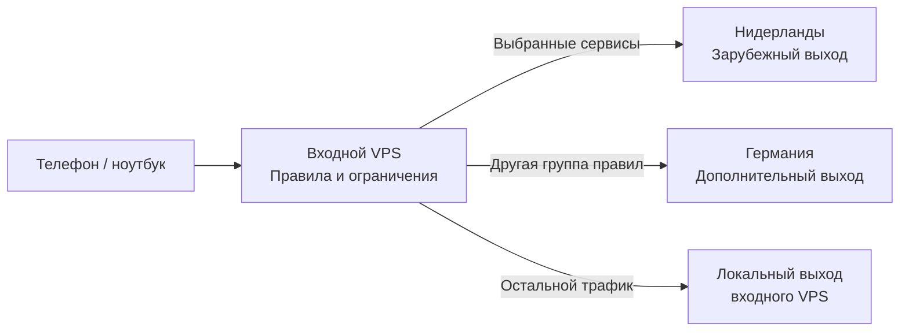
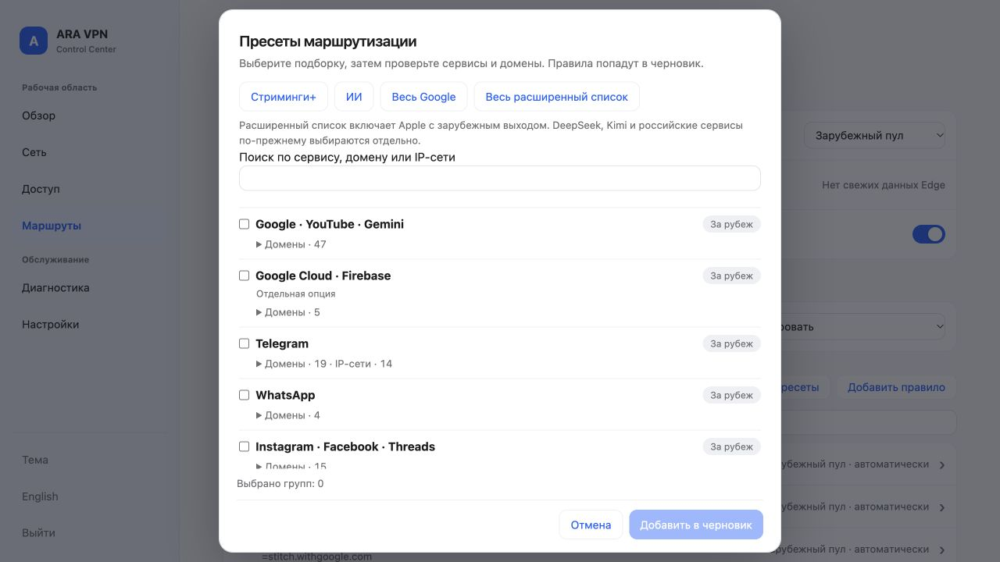
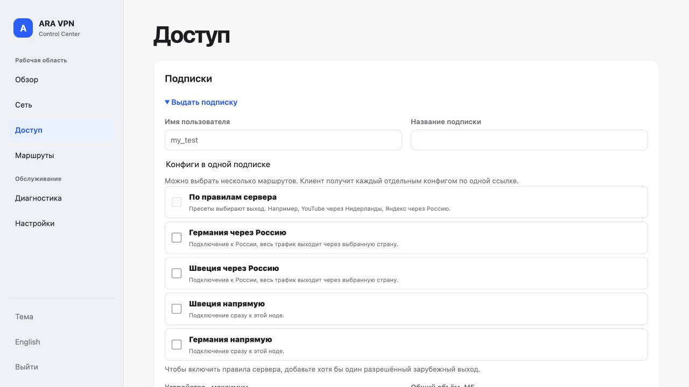
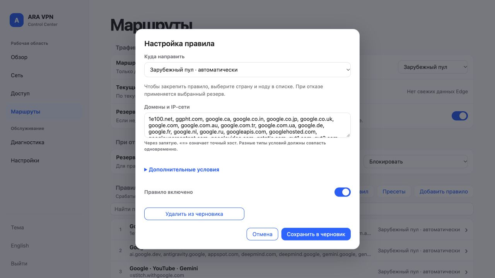
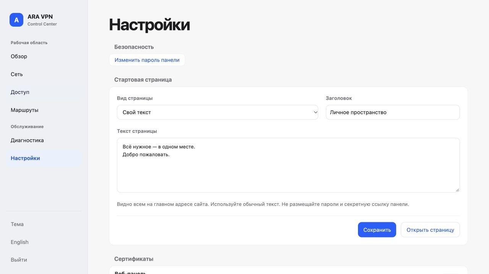
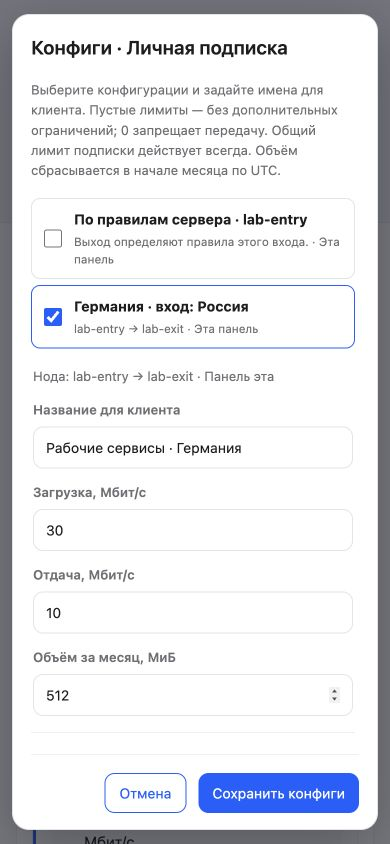
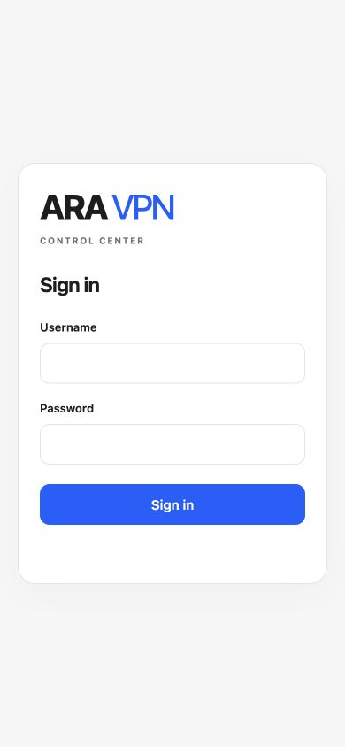

<p align="center"></p>

<h1 align="center">ARA VPN</h1>
<p align="center"><strong>Своя VPN-сеть для доступа к нужным сервисам.</strong><br>Вход рядом с вами. Выход там, где нужно. Управление в одной панели.</p>

<p align="center">
<a href="https://github.com/ARA-VPN-Project/ARA-VPN/releases/latest"></a>
<a href="LICENSE"></a>
<a href="docs/GETTING_STARTED.md"></a>
<a href="docs/ACCEPTANCE_0.1.1.md"></a>
<a href="docs/ACCEPTANCE_0.1.1.md"></a>
</p>

<p align="center"><a href="#начать"><strong>Установить</strong></a> · <a href="#выберите-свой-сценарий">Сценарии</a> · <a href="#сеть-которую-видно">Интерфейс</a> · <a href="docs/USE_CASES.md">Руководство</a> · <a href="README.en.md">English</a></p>

**ARA помогает обходить блокировки на вашей инфраструктуре.** Соедините входную ноду с зарубежным выходом, выберите сервисы и выдайте пользователю одну подписку. Нужные сайты пойдут через выбранную страну, остальные — по вашей политике. Хотите ещё один выход, отдельный профиль для видео или более строгий лимит прямого подключения? Всё это остаётся частью одной управляемой сети.

Здесь нет обязательного облачного аккаунта ARA. Серверы, доступ, ключи и правила остаются под вашим управлением.



## Не просто список серверов

| Что вы хотите | Что даёт ARA |
|---|---|
| Открывать нужные сервисы | Пресеты доменов и сетей, редактор правил и выбор выхода для каждого правила |
| Подключаться через удобную входную точку | Проходной маршрут «устройство → вход → зарубежный выход» |
| Иногда отправлять весь VPN-трафик за рубеж | Отдельный прямой или фиксированный проходной профиль в той же подписке |
| Делиться доступом без путаницы | Ссылка и QR, несколько конфигураций, отдельные устройства и отзыв |
| Контролировать расход | Общие лимиты пользователя и устройств, дополнительные ограничения конфигураций |
| Понимать, где проблема | Доступность нод, задержка, история трафика и измерение скорости по участкам |
| Настраивать сеть повторяемо | Web UI для повседневной работы, CLI/API и plan/apply для автоматизации |

## Выберите свой сценарий

### 1. Входной VPS → зарубежный выход

**Наш основной рабочий сценарий.** Первый сервер принимает подключение пользователя, второй обеспечивает выход за рубежом. Для дополнительных групп сервисов можно добавить третий сервер и назначить другой выход.



Внешние ноды не обязаны находиться именно в этих странах. Вы выбираете страны, сервисы и поведение при отказе: резервный выход, локальный выход, если это разрешено, или строгую блокировку. **ARA не должна менять страну или выпускать трафик локально вопреки выбранной политике.**

### 2. Домашний вход → Нидерланды

Мини-ПК, NAS или виртуальная машина с Debian дома становится вашей входной нодой. Зарубежный VPS — выходом для выбранных сервисов. Например, видео и ИИ идут через Нидерланды, а остальной трафик — через домашний интернет.


**Для прямого входящего подключения к домашней ноде нужен белый, публично доступный IP и роутер с возможностью пробросить порт.** На роутере откройте выбранный порт транспорта к Debian-устройству; если подписка обслуживается дома, обеспечьте также доступ к её HTTPS-порту. За CGNAT одного проброса порта недостаточно. Статический IP удобен, а при динамическом понадобится актуальное DNS/DDNS-имя. ARA устанавливается на Debian-хост, а не является прошивкой для любого домашнего роутера.

### 3. Один зарубежный сервер — VPN напрямую

Начните с одной ноды: «устройство → Нидерланды → интернет». Позже добавьте входную ноду или второй выход. **«Напрямую» здесь означает VPN до зарубежного сервера**, а не DIRECT без VPN. Можно выдать прямой и проходной варианты в одной подписке.

### 4. Семья или небольшая команда

Одна подписка, собственная identity у каждого устройства и общий бюджет. Потеряли телефон — отзовите его доступ, сохранив ноутбук. Ограничьте число зарегистрированных устройств, скорость и объём. Для варианта «весь трафик через внешний выход» задайте отдельный лимит, сохранив более свободный профиль по правилам.

[Подробные сценарии и последовательность настройки →](docs/USE_CASES.md)

## Сеть, которую видно

Не запоминайте, какой сервер скрывается за очередной ссылкой. Дайте маршрутам понятные имена, выберите сервисы, выдайте доступ и смотрите подтверждённый расход.

<table>
<tr><td width="50%"><strong>Готовые подборки сервисов</strong><br>Просмотрите домены, включите нужное и выберите выход.</td><td width="50%"><strong>Несколько вариантов в одной подписке</strong><br>Прямое подключение и маршруты по правилам рядом.</td></tr>
<tr><td></td><td></td></tr>
<tr><td><strong>Правило с понятным назначением</strong><br>Домен, сеть, порт, протокол и действие.</td><td><strong>Своя публичная страница</strong><br>Нейтральная заглушка или ваш текст; панель — отдельно.</td></tr>
<tr><td></td><td></td></tr>
</table>

<p align="center">&nbsp;&nbsp;</p>

Скриншоты сняты на тестовой установке, без паролей и действующих клиентских QR. [Вся галерея →](docs/SCREENSHOTS.md)

## Процессоры и платформы

| Архитектура | Где используется | Статус 0.1.1 |
|---|---|---|
| **amd64 / x86‑64** | Обычные 64-битные Intel и AMD, большинство VPS и мини-ПК | Готовые .deb, native Debian и реальные подключения проверены |
| **armhf / ARMv7** | 32-битные ARM-устройства с ARMv7 | Готовые .deb; тесты и трафик через Edge/Exit проверены под QEMU |
| **arm64 / AArch64** | 64-битные ARM-серверы и платы | Цель сборки предусмотрена; проверенных пакетов в этом выпуске нет |

ARMv7-эмуляция не подменяет испытание физического устройства. Серверная платформа
этого выпуска — Debian; сторонний VPN-клиент на телефоне или компьютере является
отдельной программой.

## Начать

Нужен **Debian с systemd** на сервере выбранной роли. Основная проверенная платформа — Debian 13 amd64; ARMv7 проверен в user-mode эмуляции. Подготовьте доступ к консоли и выберите свободные порты.

```sh
curl -q -fsSL --proto '=https' --proto-redir '=https' https://raw.githubusercontent.com/ARA-VPN-Project/ARA-VPN/v0.1.1/install.sh | sudo sh
```

Мастер попросит домен **или IP**, предложит порт панели **29445** и поможет выбрать TLS: свой сертификат, локальный сертификат или ACME для домена. После настройки он покажет полную секретную ссылку панели, логин и первоначальный пароль. По умолчанию панель привязана к loopback; удалённый доступ включается явно.

**После установки:** подготовьте выход, затем вход, настройте связь и правила, создайте пользователя и выдайте подписку. Установка пакетов не поднимает произвольную удалённую сеть сама: первоначальная подготовка транспорта остаётся консольным шагом. Дальше повседневное управление доступно в панели. [Пошаговая инструкция →](docs/GETTING_STARTED.md)

## Ответы перед первым запуском

**Нужен домен?** Для работы ARA он не обязателен: можно использовать IP и собственный CA. Но удалённый клиент должен доверять сертификату. Публичный домен с корректным DNS удобнее для автоматического TLS и обычных HTTPS-ссылок.

**Какие клиенты подключаются?** ARA экспортирует стандартные ссылки для совместимых сторонних клиентов. Рабочее подключение проверено независимым sing-box-клиентом. Поддержка формата не означает, что каждое приложение на каждом телефоне прошло отдельную приёмку.

**Как соединяются серверы?** Есть транспортные профили между нодами и управляемый ARA жизненный цикл OpenVPN/WireGuard backbone. Выбор клиентского входа и выбор транспорта между серверами — разные настройки. [Протоколы и роли →](docs/PROTOCOLS.md)

**Увидит ли ARA два телефона с одним QR как два устройства?** Нет: одна скопированная identity остаётся одним зарегистрированным устройством. Для отдельного учёта и отзыва выдайте каждому собственную identity.

**При падении выхода всё уйдёт напрямую?** Только если это явно разрешено вашей политикой. Для закреплённого выхода можно выбрать fail-closed. Проверяйте реальный маршрут и отказ, а не только состояние кнопки.

**Это новый VPN-протокол?** Нет. ARA объединяет стандартные транспорты, маршрутизацию, доступ и учёт. Встроенный движок не означает автоматическую поддержку всех его возможностей на каждом входе. Доступность сервиса зависит и от сети, провайдера и выбранного транспорта; обещаний универсального обхода нет.

## Документация

[Установка](docs/GETTING_STARTED.md) · [Сценарии](docs/USE_CASES.md) · [Консоль и инструкции агентам](docs/AGENT_QUICKSTART.md) · [Протоколы](docs/PROTOCOLS.md) · [Приёмка](docs/ACCEPTANCE_0.1.1.md) · [Проверка публичного комплекта](docs/PUBLICATION_SECURITY_0.1.1.md) · [Сообщить о проблеме](https://github.com/ARA-VPN-Project/ARA-VPN/issues)

**0.1.1 принята в согласованном native Debian объёме.** Docker runtime, физический ARMv7 и полевые DPI-замеры не объявляются пройденными. Это не меняет доступные функции и не заменяет проверку вашей топологии. [Точная матрица результатов →](docs/ACCEPTANCE_0.1.1.md)

## Лицензия

Собственный код — **[AGPL-3.0-or-later](LICENSE)**. Коммерческое использование допускается на условиях лицензии. Сторонние компоненты сохраняют свои условия, sing-box — GPL-3.0-or-later. [Уведомления](NOTICE) · [Исходники компонентов](SOURCES.md) · [Бренд](TRADEMARKS.md).
