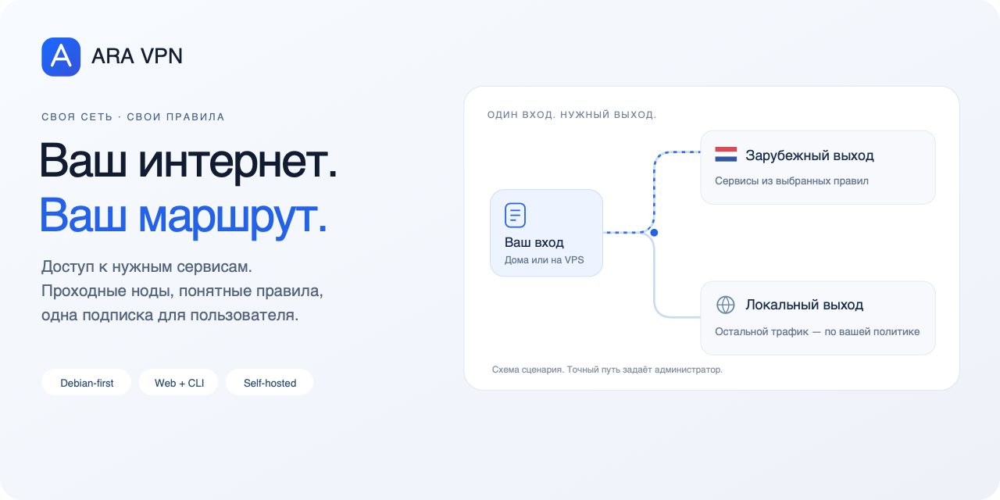

# ARA VPN 0.1.1 · свой вход, нужный выход



**Первый публичный выпуск ARA VPN — своей VPN-сети для доступа к нужным сервисам.**
Проходные ноды, правила по сервисам, одна подписка с несколькими маршрутами и
управление доступом в Web UI или CLI.

## Выберите свою сеть

- **Входной VPS → зарубежный выход.** Примите подключение в удобной точке,
  отправьте нужные сервисы за рубеж, а остальным задайте локальный маршрут.
  Несколько выходов могут обслуживать разные группы правил.
- **Домашний Debian → Нидерланды.** Мини-ПК, NAS или VM дома плюс внешний VPS.
  Для входящего подключения домой нужен **белый IP и роутер с пробросом порта**;
  при динамическом адресе — актуальный DNS/DDNS. CGNAT одним пробросом не решить.
- **Одна зарубежная нода.** Прямой VPN без обязательного промежуточного сервера.
- **Семья или команда.** Отдельные устройства, общий бюджет и дополнительные
  ограничения каждого профиля, без нескольких несвязанных подписок.

## Установить

```sh
curl -q -fsSL --proto '=https' --proto-redir '=https' https://raw.githubusercontent.com/ARA-VPN-Project/ARA-VPN/main/install.sh | sudo sh
```

Нужен Debian с systemd и curl. Мастер принимает домен **или IP**, предлагает
порт панели **29445** и способ настройки TLS, затем выдаёт полную ссылку,
логин и первоначальный пароль. Loopback — безопасный вариант по умолчанию;
удалённый доступ включается явно. Для роли выхода: `sudo sh -s -- edge`
в конце той же команды. Первоначальная подготовка транспорта — консольный шаг,
после которого маршруты и доступ управляются в панели.

## Что внутри

- Пресеты сервисов, редактор правил, конкретные выходы и явная политика отказа.
- Прямые и проходные конфигурации в одной подписке, ссылка/QR, клиентские имена.
- Общие account/device лимиты, дополнительные скорость и месячный объём профилей.
- Связанные панели с делегированными правами и авторитетным владельцем бюджета.
- Доступность, задержка, история трафика и диагностика скорости по участкам.
- RU/EN, интерфейс для больших и узких экранов, CLI/API и plan/apply.
- Проверяемая поставка с лицензиями и исходниками компонентов.

## Процессоры

| Пакеты | Проверка |
|---|---|
| **amd64 / x86-64 · Intel и AMD 64-bit** | Native Debian, настоящие подключения |
| **armhf / ARMv7** | QEMU user-mode, тесты и payload через эмулируемые Edge/Exit |

arm64 является целью сборки, но проверенных пакетов в этом выпуске нет.
Docker runtime и физический ARMv7 отдельно не квалифицированы. Возможности
клиентского входа и межсерверного транспорта различаются. [Матрица протоколов](https://github.com/ARA-VPN-Project/ARA-VPN/blob/v0.1.1/docs/PROTOCOLS.md).

[**Начать с руководства →**](https://github.com/ARA-VPN-Project/ARA-VPN/blob/v0.1.1/docs/GETTING_STARTED.md) ·
[Сценарии](https://github.com/ARA-VPN-Project/ARA-VPN/blob/v0.1.1/docs/USE_CASES.md) ·
[Скриншоты](https://github.com/ARA-VPN-Project/ARA-VPN/blob/v0.1.1/docs/SCREENSHOTS.md) ·
[English](https://github.com/ARA-VPN-Project/ARA-VPN/blob/v0.1.1/README.en.md)

Собственный код — AGPL-3.0-or-later; сторонние лицензии сохранены. Вместе с
бинарниками публикуются исходники ARA, Go-модулей/движка и нативной части.
Проверяйте RELEASE-SHA256SUMS. [Приёмка и границы](https://github.com/ARA-VPN-Project/ARA-VPN/blob/v0.1.1/docs/ACCEPTANCE_0.1.1.md).
