# ARA VPN · интерфейс

Снимки реальной установленной панели 0.1.1 на тестовой Debian VM. Desktop-снимки — 1280 × 720, мобильный — узкий экран. Тестовые названия нод не означают географию или доступность боевых выходов. Секретные ссылки, пароли и QR доступа не показаны.

## Маршруты и поведение при отказе

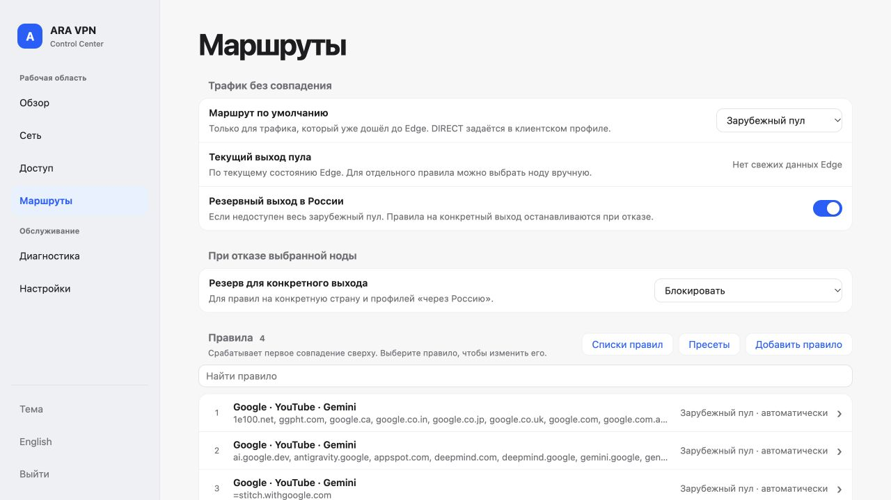

Маршрут по умолчанию, отдельная политика отказа и список правил. Отсутствие свежего состояния Edge показано явно.

## Пресеты сервисов

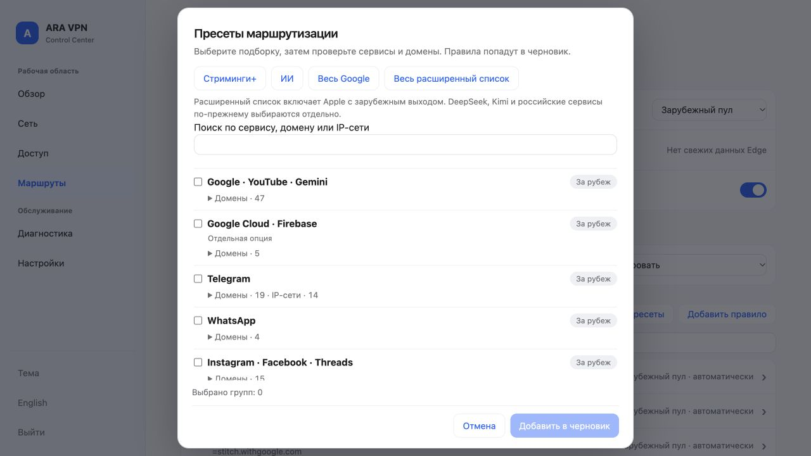

Список сервисов, поиск и раскрытие доменов/IP-сетей. Выбор добавляет правила в черновик. Apple использует зарубежный выход.

## Редактор одного правила

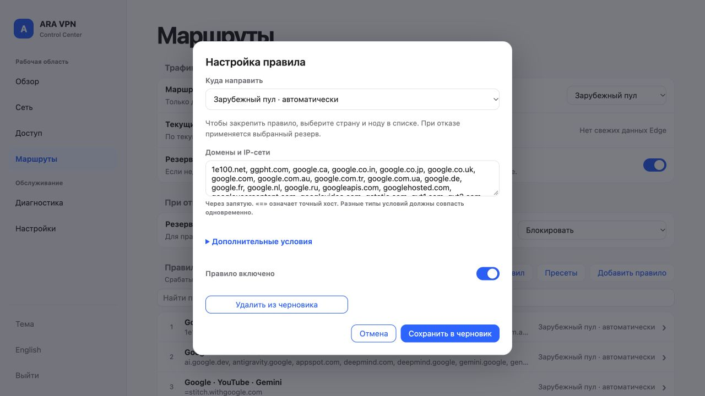

Выбор действия, назначения и параметров правила.

## Создание подписки

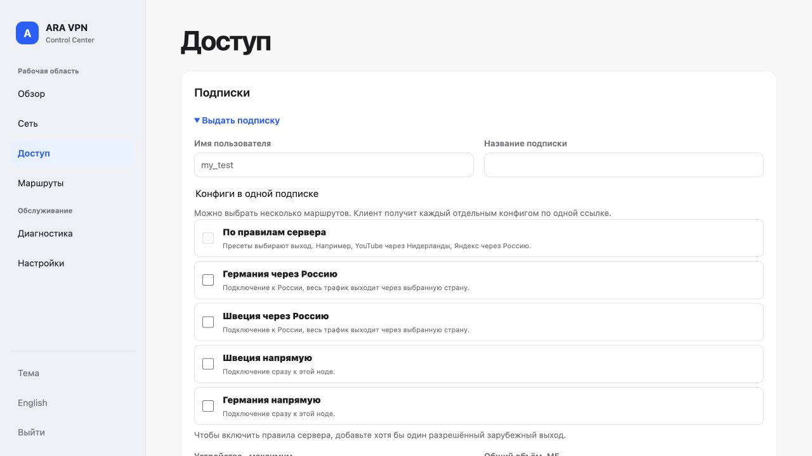

Прямые и проходные варианты, включая ноду, переданную связанной панелью. Скриншот демонстрирует форму, а не исполнение всех удалённых ограничений.

## Настройка публичной страницы

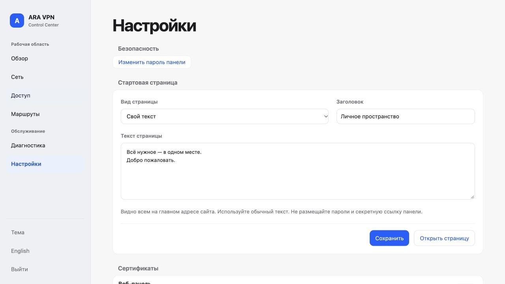

Выбор вида, заголовка и текста, предпросмотр и сохранение.

## Публичная страница

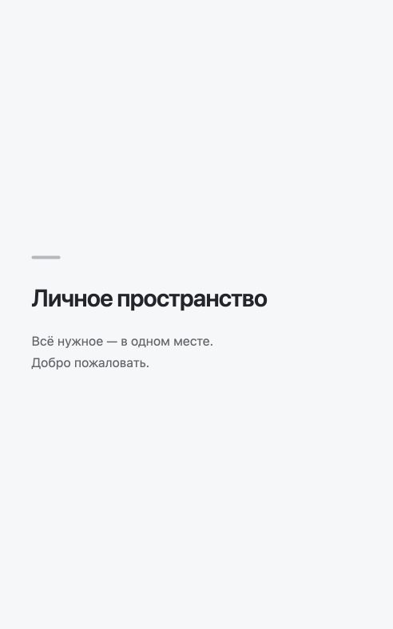

Свой текст в корне сайта; адрес панели остаётся отдельным.

## Узкий экран

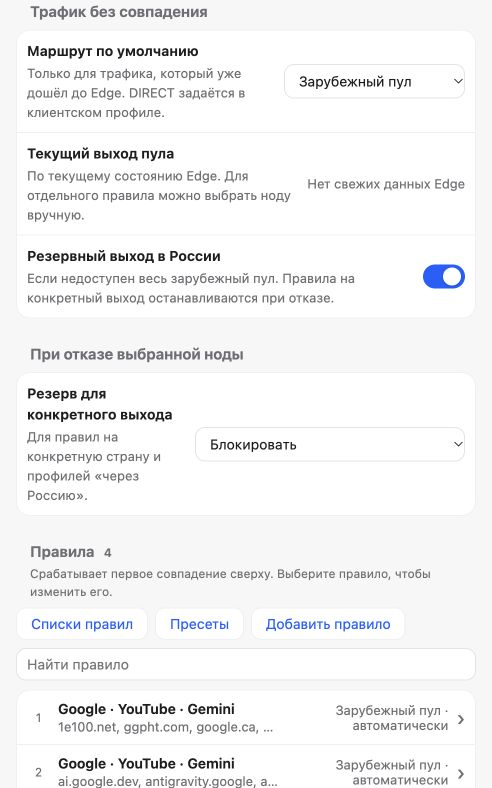

Полный статус продукта — в [отчёте приёмки](ACCEPTANCE_0.1.1.md). Галерея не является свидетельством общей готовности к эксплуатации.

## Вход в панель

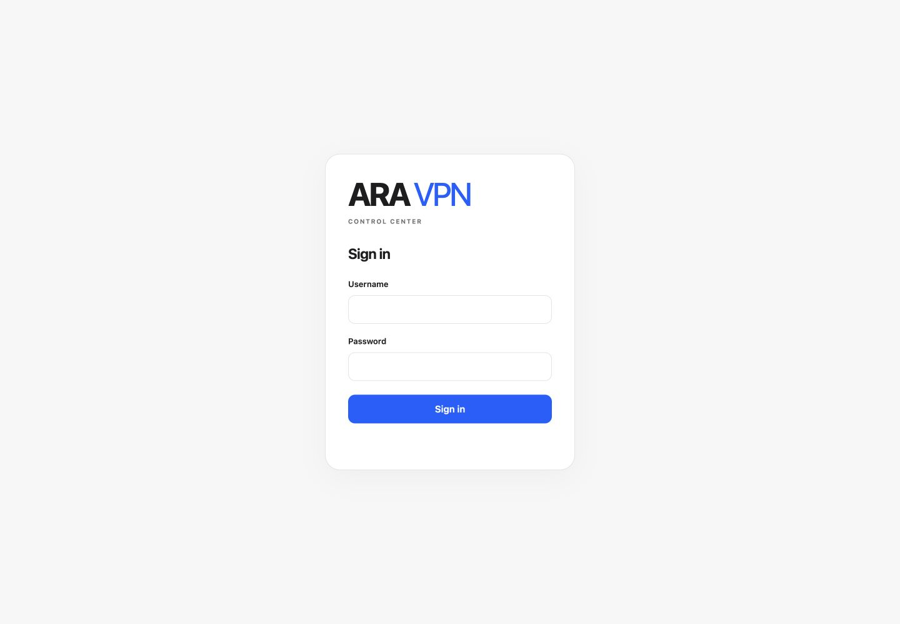

Отдельная страница входа доступна по секретному адресу панели. Карточка и слово ARA VPN выровнены по центру экрана; публичный корень не показывает форму входа.

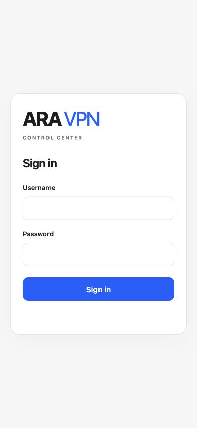

## Названия и ограничения конфигураций

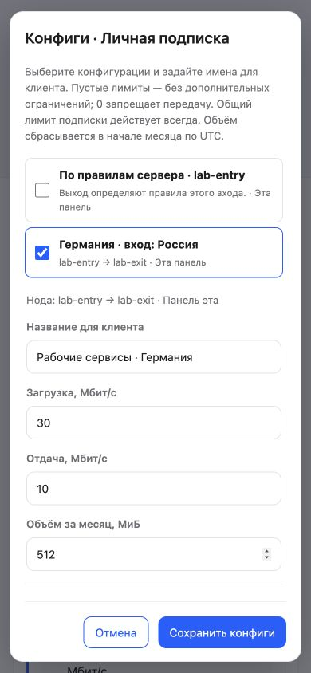

Имя для клиента отделено от технического маршрута. Дополнительные скорость и месячный объём задаются для каждого варианта. Заголовок и действия остаются видимыми при прокрутке длинного списка. Это снимок тестовой подписки, без ссылки и QR доступа.

## Подписка после чистой установки

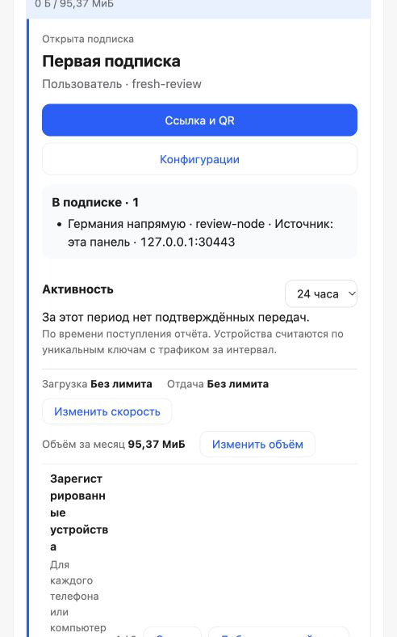

Нода и подписка созданы через браузер после установки со скачиванием пакетов. Показаны выбранный маршрут, общий объём и три слота устройств. Ссылка, пароль и QR доступа скрыты. Работа транспорта проверяется отдельно; появление карточки не считается доказательством запущенного слушателя.
