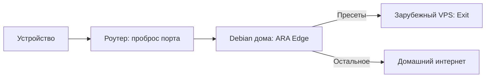

# ARA VPN · от первого сервера до своей сети

Один сервис для своей VPN-сети. Начните с одной ноды, добавьте внешний выход и выдайте пользователю одну подписку с несколькими способами подключения. Панель помогает видеть маршруты и расход, а консоль позволяет повторять настройку и поручать её агенту.

## Домашняя входная нода + зарубежный VPS

**Для кого.** Хочется иметь свой домашний вход и отправлять выбранные сервисы
через зарубежную ноду, сохранив для других сайтов домашний выход.

1. Убедитесь, что WAN-адрес публичный: **белый IP**, а не CGNAT. Роутер должен
   позволять проброс выбранного входного порта к вашему Debian-хосту.
2. Закрепите LAN-адрес домашнего хоста. Для динамического публичного адреса
   поддерживайте DNS/DDNS; статический белый IP удобнее, но не обязателен.
3. На зарубежном VPS подготовьте выход. Затем дома настройте входной слушатель,
   сертификат, связь и политику. Ключевой материал и bootstrap — через консоль.
4. Пробросьте транспортный порт на роутере. Если публичная подписка выдаётся дома,
   сделайте доступным и её HTTPS-порт. Панель можно оставить приватной.
5. Создайте пользователя и подписку в панели. Разрешите «По правилам сервера» и,
   если нужно, отдельный фиксированный зарубежный профиль с более строгим лимитом.
6. Проверьте запрос из пресета и вне списка, настоящий IP выхода, лимиты и отказ.
   Повторите проверку с внешней сети, а не только из своей LAN.

Обычный проброс порта не устраняет CGNAT. Публичный домен не заменяет доступный
IP. ARA ставится на Debian-компьютер/VM, а не на произвольный роутер как прошивка.

## Входной VPS + один или несколько внешних выходов

**Для кого.** Домашний вход не нужен или недоступен, а управлять хочется всей
цепочкой: подключение клиента, маршруты, разные страны и учёт.

Подготовьте входной VPS и зарубежный выход. Выберите пресеты, которые должны
идти через него; для остальных задайте локальный выход входной ноды или другую
явную политику. При появлении второго выхода назначьте его отдельным группам
сервисов. Например, видео — Нидерланды, ИИ-сервисы — Германия. Это пример, а не
встроенная зависимость от стран: имена и назначения выбираете вы.

В подписке можно одновременно предложить профиль по правилам, фиксированный
зарубежный маршрут через вход и прямой VPN к зарубежной ноде, если её клиентский
слушатель подготовлен и доступен. Задайте каждому понятное клиентское имя.

## Первый сервер: установить, настроить, подключиться

**Для кого.** Владелец небольшого сервера, который хочет управлять доступом через браузер.

1. Установите пакеты своей роли по инструкции. Укажите домен или IP, порт панели и способ получения сертификата. Сохраните выданные адрес, логин и пароль.
2. Откройте секретный адрес панели. Публичный корень остаётся отдельной страницей. При локальном сертификате настройте доверие на своём устройстве.
3. Добавьте ноду в «Сети». Выберите понятное имя, страну и роль. Укажите адрес клиентского входа и TLS-имя.
4. Подготовьте серверный слушатель, сертификат и конфигурацию Edge. В текущем выпуске этот этап требует консольных команд из инструкции. Запись адреса в панели сама по себе не запускает слушатель.
5. В «Доступе» создайте пользователя и подписку. Выберите доступные конфигурации, срок, объём и количество устройств.
6. Откройте «Ссылка и QR», импортируйте совместимый формат в клиент. Проверьте загрузку подписки, подключение и фактический адрес выхода.

**Результат.** Пользователь получает свой доступ, а администратор видит его ограничения и подтверждённый расход. Успех подтверждается запросом через туннель, а не только появлением ссылки.

## Прямое подключение: один профиль, один выход

**Задача.** Весь направленный в VPN трафик должен выходить через выбранную ноду.

Настройте на внешней ноде вход и выход в интернет. Добавьте её клиентский адрес в панели, затем выберите прямой профиль в подписке. «Напрямую» означает VPN до этой ноды. Для локального доступа без VPN используется отдельное решение DIRECT в поддерживаемом клиентском режиме.

Проверьте IP выхода, отзыв доступа и ограничения пользователя. Отдельные ограничения профиля должны дополнять общий бюджет пользователя. Переход к другому профилю не должен обнулять расход.

## По правилам: нужные сервисы через внешний выход

**Задача.** Выбранные сервисы идут через внешнюю ноду, остальное — по заданному маршруту по умолчанию.

1. Подготовьте входную и внешнюю ноды. Установите транспорт между ними и проверьте его отдельно.
2. Создайте связь Edge → Exit. Страна здесь является вашей меткой ноды, а не автоматической проверкой адреса.
3. В «Маршрутах» откройте пресеты, выберите сервисы и просмотрите домены. Добавьте подборку в черновик, проверьте и сохраните.
4. Доставьте конфигурацию и политику на Edge штатным plan/apply/sync. Для локального DIRECT настройте также клиентскую сторону.
5. В одной подписке разрешите профиль «По правилам сервера» и нужные профили с фиксированным выходом.

Проверьте адрес из пресета и адрес вне списка. Затем проверьте отказ выбранного выхода. Поведение определяется политикой: блокировка, другая нода или российский резерв. Переход в другую страну должен соответствовать настройке профиля.

## Несколько выходов: выбирать маршрут осознанно

Разные группы сервисов могут использовать разные выходы. Например, одна группа — ноду A, другая — ноду B. Дайте нодам понятные имена, задайте приоритеты и явно выберите резерв. Для строгих маршрутов закрепляйте конкретный выход.

Перед выдачей подписки проверьте каждый маршрут с клиента. Страна в названии профиля помогает ориентироваться, но фактический IP и доступность сайта подтверждаются отдельным запросом.

## Связанные панели: один владелец подписки

**Задача.** Главная панель выдаёт подписку с конфигурациями доступных ей ARA-нод.

Свяжите панели одноразовым административным приглашением. Передайте только нужные полномочия. Затем опубликуйте разрешённую топологию: сам факт связи не является обменом всеми нодами и пользователями.

После обмена проверьте наличие прямого профиля удалённой ноды в форме подписки. Общие ограничения пользователя и отдельные ограничения конфигурации должны применяться на обслуживающей ноде. Для распределённого расхода нужен авторитетный владелец и выдача ограниченных прав расхода. Отсутствие владельца не должно создавать unlimited.

**Граница текущей приёмки.** Импорт ноды и появление её профиля в главной панели проверены. Первоначальный обмен и подготовка transport runtime требуют консольных шагов. Наличие профиля в каталоге не заменяет проверки его подключения и ограничений на обслуживающей ноде; границы принятого сценария описаны в ACCEPTANCE_0.1.1.md.

## Агент разворачивает — человек пользуется

Дайте агенту список разрешённых серверов, роли, адреса, порты и ожидаемые маршруты. Он снимает состояние, готовит резервную копию, устанавливает пакеты, настраивает выход, затем вход и доставляет проверенный план. Все секреты остаются в защищённых файлах.

Готовый результат для владельца — адрес панели и отчёт о проверках. Для пользователя — подписка с понятными названиями конфигураций. Агент должен проверить подключение, фактический выход, лимиты, отзыв и восстановление после перезапуска. [Команды и правила для агента](AGENT_QUICKSTART.md).

## Своя публичная страница

В настройках задайте нейтральный заголовок и текст для посетителей главного адреса. Можно разместить описание своего проекта или инструкцию. Доступ к администрированию остаётся по отдельной секретной ссылке. [Настройка страницы](PUBLIC_PAGE.md).

## Семья: одна подписка, разные устройства

Откройте подписку и установите число слотов. Нажмите «Добавить устройство» для телефона или компьютера и передайте каждому собственный QR. Так можно отозвать потерянный телефон, не отключая ноутбук; расход устройств входит в один общий бюджет. Копирование одного QR на все устройства лишает систему возможности различать их физически.

В «Конфигурациях» назовите варианты, например «Работа · через вход» и «Видео · напрямую». У администратора рядом остаются техническая нода и источник, а клиент получает короткие понятные имена. Дополнительный месячный объём и скорость каждого варианта действуют вместе с общими ограничениями пользователя. Исчерпание прямого варианта не должно блокировать другой вариант, если общий бюджет ещё есть.
